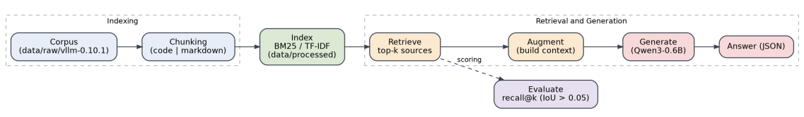

*This project has been created as part of the 42 curriculum by lupalomi*

# Description
RAG, which stands for **Retrieval-Augmented Generation**, or in spanish **Generación Aumentada por Recuperación**, is a pattern that combines `parametric memory`, learned by the model during training, with `on-parametric memory`, provided by an external index that is queried at inference time.

A RAG system is divided in two parts: "**Indexing**" and "**Retrieval and Generation**"

<div align="center">
    
</div>

The final quality depends not only on the model, but also on the quality of the retrieval process.

### Types of memory
As it's been said, the pattern will implement two kinds of memory:

- **Parametric memory**: What the model learnt during training and which has been encoded in its parameters. It is fast, always available, and cannot be directly accessed or corrected.

- **Non parametric memory**: An external index that is consulted in real time. It can be updated, audited and cited.

### Why non parametric memory changes the problem?
When you move the knowledge out of the model, it's possible to update the sources without training, the answer can be quoted and it's possible control the access if a user doesn't have the correct permissions.

### When is it useful to implement a RAG system?
A RAG system is especially useful when **information is constantly changing, the model lacks the required knowledge or it is necessary to cite the source of a statement**.

### When is it not useful to implement a RAG system?
A RAG system may not be the best solution when **the task only requires a specific output format, a repetitive task with many examples** could be better addressed through fine-tuning, **the model doesn't understand the prompt or the available information is small enough to fit directly into the model's context**.

## Indexing


### Chunking Strategy
Inside the `chunkers.py` file, it's possible find the **class Chunker** that defines the basic structure of each strategy, and the **class Chunk** that contains the neccesary knowledge to split a file in multiple sections.

```Python
from abc import ABC, abstractmethod
from pathlib import Path
from pydantic import BaseModel, Field


class Chunk(BaseModel):
    """Amount of ***python code*** or ***text*** that has been properly cut"""
    file_path: Path
    line_start: int = Field(default=1, ge=1)
    line_end: int = Field(default=1, ge=1)
    first_character_index: int = Field(default=0, ge=0)
    last_character_index: int = Field(default=0, ge=0)
    content: str = Field(default="")

    def update_content(self, new_end: int, new_content: str) -> None:
        if new_end:
            self.line_end = new_end

        if new_content:
            self.content = new_content


class Chunker(ABC):
    def __init__(self, max_chunk_size: int = 2000) -> None:
        if max_chunk_size <= 0:
            raise ValueError("max_chunk_size must be positive")
        self.max_chunk_size = max_chunk_size

    @abstractmethod
    def chunk_file(self, file: Path) -> list[Chunk]:
        pass
```

#### Python strategy
The ***Python Chunking Strategy*** uses an **AST-based strategy** to identify structural boundaries in source code, such as imports, functions, and classes. It aims to preserve the logical organization of the source code while ensuring that every chunk respects the *max_chunk_size* given by the user.

The strategy follows a hierarchical approach:
1. **Syntax analysis:** Parses Python source files using *ast.parse()*.
2. **Boundary detection:** Identifies the beginning and end of AST nodes, including decorators.
3. **Structural splitting:** Detects method-level boundaries when classes exceed the *max_chunk_size*.
4. **Dynamic grouping:** Combines consecutive code regions as long as their total size remains within the limit.
5. **Fallback splitting:** Divides oversized regions by complete lines, resorting to character-level splitting when necessary.
6. **Content preservation:** Retains the original source code, including comments, whitespace, and indentation.

#### Text strategy


## System Architecture

## Retrieval Method

## Performance Analysis

## Design Decisions

## Challenges Faced

## Example Usage

# Instructions

# Resources

## Libraries and tools
- [Python Fire](https://github.com/google/python-fire)
- [TQDM](https://github.com/tqdm/tqdm)

## Indexing
⚠️ ​*Since my main language is spanish, many of these links are from spaniards websites* ⚠️​

- [[🇪🇸​] How create a RAG system with your own documents](https://underc0de.org/guias/inteligencia-artificial/como-crear-un-sistema-rag-con-documentos-propios/)
- [[🇪🇸​] What's an index in RAG data bases and how optimise it?](https://dinogeek.me/ES/RAG/Que-es-un-indice-en-las-bases-de-datos-RAG-y-como-optimizarlo.html)
- [[🇬🇧​] Document Indexing Using TF-IDF](https://medium.com/codex/document-indexing-using-tf-idf-189afd04a9fc)
- [[🇬🇧​] What is BM25 Full-Text Search?](https://spice.ai/learn/bm25-full-text-search)
- [[🇬🇧​] How to Check If a Path Is a Directory in Python](https://labex.io/tutorials/python-how-to-check-if-a-path-is-a-directory-in-python-559557)
- [[🇬🇧​] The ultimate guide for chunking strategies](https://agenta.ai/blog/the-ultimate-guide-for-chunking-strategies)
- [[🇬🇧​] How to do chunking in python](https://thinkingneuron.com/how-to-do-chunking-in-python/)
- [[🇬🇧​] Building code-chunk: AST Aware Code Chunking](https://supermemory.ai/blog/building-code-chunk-ast-aware-code-chunking/)
- [[🇬🇧​] The Ultimate Text Chunking Toolkit: 15 Methods with Python Code](https://medium.com/data-science-collective/the-ultimate-text-chunking-toolkit-15-methods-with-python-code-9ef9d8f6a898)
- [[🇬🇧​] 10 Chunking Strategies That Make or Break Your RAG Pipeline](https://dev.to/klement_gunndu/10-chunking-strategies-that-make-or-break-your-rag-pipeline-4cng)
- [[🇬🇧​] AST documentation](https://docs.python.org/3/library/ast.html)