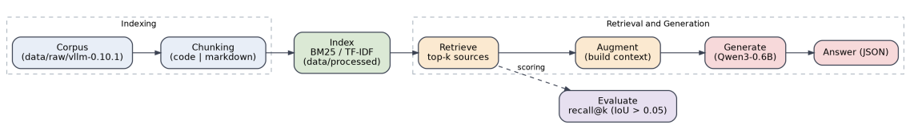

*This project has been created as part of the 42 curriculum by lupalomi*

# Description
RAG, which stands for **Retrieval-Augmented Generation**, or in spanish **Generación Aumentada por Recuperación**, is a pattern that combines `parametric memory`, learned by the model during training, with `on-parametric memory`, provided by an external index that is queried at inference time.

A RAG system is divided in two parts: "**Indexing**" and "**Retrieval and Generation**"

    

The final quality depends not only on the model, but also on the quality of the retrieval process.

### Types of memory
As it's been said, the pattern will implement two kinds of memory:

- **Parametric memory**: What the model learnt during training and which has been encoded in its parameters. It is fast, always available, and cannot be directly accessed or corrected.

- **Non parametric memory**: An external index that is consulted in real time. It can be updated, audited and cited.

### Why non parametric memory changes the problem?
When you move the knowledge out of the model, it's possible to update the sources without training, the answer can be quoted and it's possible control the access if a user doesn't have the correct permissions.

### When is it useful to implement a RAG system?
A RAG system is especially useful when **information is constantly changing, the model lacks the required knowledge or it is necessary to cite the source of a statement**.

### When is it not useful to implement a RAG system?
A RAG system may not be the best solution when **the task only requires a specific output format, a repetitive task with many examples** could be better addressed through fine-tuning, **the model doesn't understand the prompt or the available information is small enough to fit directly into the model's context**.

## Indexing

### Chunking Strategy

## System Architecture

## Retrieval Method

## Performance Analysis

## Design Decisions

## Challenges Faced

## Example Usage

# Instructions

# Resources

## Libraries and tools
- [Python Fire](https://github.com/google/python-fire)
- [TQDM](https://github.com/tqdm/tqdm)

## Indexing
⚠️ ​*Since my main language is spanish, many of these links are from spaniards websites* ⚠️​

- [How create a RAG system with your own documents (in spanish)](https://underc0de.org/guias/inteligencia-artificial/como-crear-un-sistema-rag-con-documentos-propios/)
- [What's an index in RAG data bases and how optimise it? (in spanish)](https://dinogeek.me/ES/RAG/Que-es-un-indice-en-las-bases-de-datos-RAG-y-como-optimizarlo.html)
